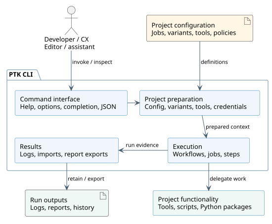

System scope and context
========================

The system boundary includes the installed PTK CLI, its packaged resources and
the optional installer that configures the current user's environment. Repository
configuration is input; child processes and external tools perform project work.

   System building blocks and principal runtime interactions.
   :download:`Edit the PlantUML source <../diagrams/system-context.puml>`.

The four blocks describe responsibilities within one CLI process, not separate
services. Preparation brings together configuration, variants, environments,
tools and credential requirements. Execution applies common scheduling and
failure rules while project tools, scripts and plugins perform the actual work.
Selected Python plugins execute inside PTK's process; the project-functionality
boundary describes ownership, not process isolation.

.. list-table:: External interfaces
   :header-rows: 1
   :widths: 25 40 35

   * - Partner
     - PTK receives
     - PTK produces
   * - Developer / shell
     - Commands, options and completion requests
     - Help, candidates, diagnostics and exit status
   * - Repository filesystem
     - Marker, conventional YAML documents, scripts and tool results
     - Generated outputs, logs, reports and explicitly synchronized files
   * - Git and CX host
     - Local history, branch/tag state and CX event metadata
     - Resolved identity/version values; no implicit metadata fetch
   * - Python / native tools
     - Executable availability and process output
     - Arguments, working directory, composed environment and cancellation
   * - Secret providers
     - Credentials selected by configuration
     - Explicit provisioning requests; masked execution output
   * - Artifact services
     - Tool archives or configured artifact resources
     - Explicit authenticated requests and destination operations
   * - Editor / assistant clients
     - CLI queries and explicit synchronization commands
     - JSON inventory/schema, bundled documentation, skills and agent instructions

A VMR is a routing workspace, not a merged project configuration. Each member
retains its own root, configuration, tools, permissions and outputs. Explicit
workspace workflows may call jobs in multiple members. Git-repo membership
comes from its index; manual membership comes from the workspace marker or
bounded direct-child discovery. See :doc:`/guides/workflows`.

System requirements specify observable contracts across these boundaries.
Software requirements refine the loader, command, execution and reporting
behavior inside PTK; they do not create artificial hardware requirements.
