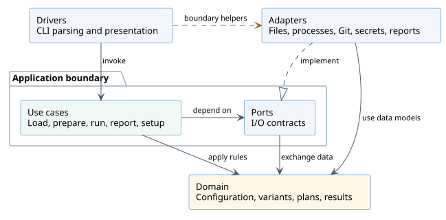

Building block view
===================

The code is organized by responsibility rather than by command alone.

   Software dependencies: arrows point to the depended-on responsibility;
   the open triangle denotes implementation of a port.
   :download:`Edit the PlantUML source <../diagrams/clean-architecture.puml>`.

The core clean-architecture idea is dependency inversion: application use cases
express the I/O contracts they need, and adapters implement those contracts.
Domain rules describe configuration, variants, execution plans and canonical
results. The composition root connects use cases to concrete adapters when
the CLI starts or a service is first needed.

.. list-table:: Principal building blocks
   :header-rows: 1
   :widths: 20 45 35

   * - Block
     - Responsibility
     - Main dependencies
   * - Drivers
     - Parse commands, route workspaces, present output and completion
     - Application services and interface adapters
   * - Application
     - Coordinate loading, preparation, execution, reports and maintenance
     - Domain rules and ports
   * - Domain
     - Typed data, validation, variant/expression rules, planning and canonical results
     - Python data structures and model libraries
   * - Adapters
     - Filesystem, YAML, processes, Git, environments, tools, secrets and report formats
     - Ports, domain data and external libraries/tools
   * - Composition root
     - Select and construct concrete implementations and built-ins
     - Application and adapters

The separation is not complete dependency isolation. Driver helpers also access
concrete adapters, shown by the dashed arrow, and some application services
perform filesystem preparation directly. There is no automated checker enforcing
every layer boundary. The diagram shows the main dependency structure rather
than a Python API catalog or a complete import graph.

Configuration and execution
---------------------------

The project loader discovers conventional configuration files and applies domain
rules for validation. Configuration schemas and ownership metadata come from the
same model. Run preparation and execution coordinate selection, parameter
resolution, planning and environment/tool preparation. Workflows schedule job
calls while preserving the owning repository's context.

Results and integrations
------------------------

The report service joins stored execution data with importer contributions.
Report exporters do not execute jobs. PTK selects its shipped importers,
exporters, generators, credential providers and installers directly. It does
not discover or load third-party entry points. Project behavior runs through
commands and independently packaged Python tools; those packages can use uv's
separate dependency environments.

See :doc:`/reference/builtins` and :doc:`/guides/python-tools`.
