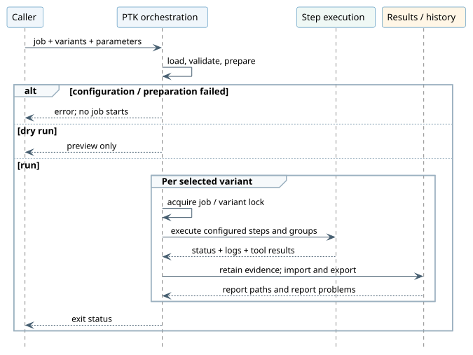

Runtime view
============

eports, then returns execution status.
   :figclass: ptk-diagram
   :target: ../_static/diagrams/job-lifecycle.svg

   Job lifecycle: preparation gates execution; results remain tied to their run.
   :download:`Edit the PlantUML source <../diagrams/job-lifecycle.puml>`.

This sequence focuses on a normal job request. A failed lock acquisition stops
that run before its steps start. A preview executes no job steps and writes only
a graph preview under ``.ptk/graphs``, without run outputs. Reporting problems are recorded separately from execution status.

Loading and command discovery
-----------------------------

1. The CLI captures invocation context and determines standalone or VMR routing.
2. Project discovery locates the marker within repository boundaries.
3. The loader reads conventional files and registered component documents,
   preserves provenance, and validates local and cross-document rules.

4. The driver exposes permitted jobs/workflows and their typed options.
   Validation can report a missing or broken project without requiring a job.

Job execution
-------------

1. Resolve requested variants, execution filters and parameter precedence.
2. Prepare paths, substitutions, environment, tools and credential requirements.
   A dry run previews the plan without executing steps or writing run reports.

3. Acquire the job/variant run lock and prepare current/history storage.
4. Schedule ready steps from their ``needs`` graph, up to ``max_workers``. Apply
   configured timeouts, retries, conditional execution and failure policies.

5. Wait for all running steps; blocked dependents retain a skip reason. Cancellation reaches active
   child processes; Python handlers must cooperate with the cancellation token.

6. Store the execution summary and captured report inputs, import contributions,
   export requested formats and apply the local report-opening policy.

The exact execution controls are documented in :doc:`/reference/execution`.
Report processing preserves execution status even when an importer fails or a
log finding is ignored. A direct CLI multi-variant selection is prepared as a
whole, then executed in selection order. Independent runs can execute in
parallel through the editor or local workflow scheduler. A concurrent run
targeting an already active job/variant fails with a lock diagnostic.

Local workflow execution
------------------------

The workflow planner resolves calls to concrete jobs and variants in their
owning repositories. A workflow's named ``jobs`` and ``needs`` form a dependency
graph. Loading rejects invalid edges and cycles. Preflight rejects output and
environment conflicts between unordered calls. Ready jobs share ``max_workers``;
each completion releases its dependents without waiting for unrelated branches.
Failed or skipped prerequisites block dependent jobs with a reason, while
independent branches continue. A tolerated failure releases dependents but remains
visible in reports. Cancellation stops pending calls and reaches active runners.
The workflow report retains child results and logs so later runs do not replace its evidence. Local workflows are
rejected in CX mode; CX pipelines invoke jobs through their own orchestration.

Historical report export
------------------------

The report service selects a retained run, reads its stored execution context,
inputs and log-analysis policy, then writes the requested export. It does not
rerun the job. Current configuration changes therefore do not silently change
the meaning of a retained diagnostic decision.
