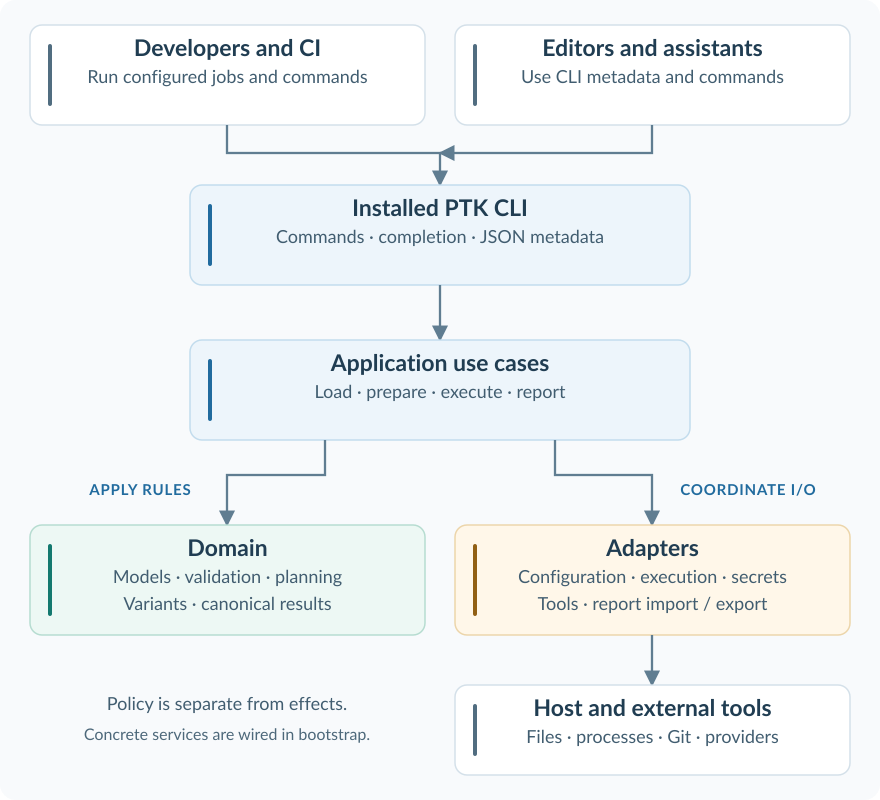

Architecture
============

Understand how PTK turns repository configuration into prepared runs and
traceable results. The CLI owns loading and execution metadata; external
integrations consume that interface. Application use cases coordinate the work,
domain rules describe behavior, and adapters perform I/O.

 export canonical results.
   :class: ptk-diagram
   :target: ../_static/diagrams/architecture-overview.svg

   Responsibilities and interaction boundaries. This is a conceptual view, not a complete Python import graph.

.. grid:: 1 1 3 3
   :gutter: 3

   .. grid-item-card:: Understand the boundaries
      :class-card: ptk-card ptk-blue
      :link: 03-system-scope-and-context
      :link-type: doc

      See what belongs to PTK and what remains with the shell, repository,
      build tools, credential providers and CI host.

   .. grid-item-card:: Follow an execution
      :class-card: ptk-card ptk-teal
      :link: 06-runtime-view
      :link-type: doc

      Follow loading, preparation, parallel variants, cancellation and
      report history through their runtime responsibilities.

   .. grid-item-card:: Review the tradeoffs
      :class-card: ptk-card ptk-amber
      :link: 09-architecture-decisions
      :link-type: doc

      Understand fixed file ownership, one loading authority, canonical
      reporting and the chosen distribution model.

The twelve arc42 chapters below describe the current CLI and its deployment
boundaries. Behavioral expectations and their review state are maintained in
:doc:`/requirements/index`; source entry points are in :doc:`/reference/modules`.

.. toctree::
   :maxdepth: 1

   01-introduction-and-goals
   02-architecture-constraints
   03-system-scope-and-context
   04-solution-strategy
   05-building-block-view
   06-runtime-view
   07-deployment-view
   08-crosscutting-concepts
   09-architecture-decisions
   10-quality-requirements
   11-risks-and-technical-debt
   12-glossary
