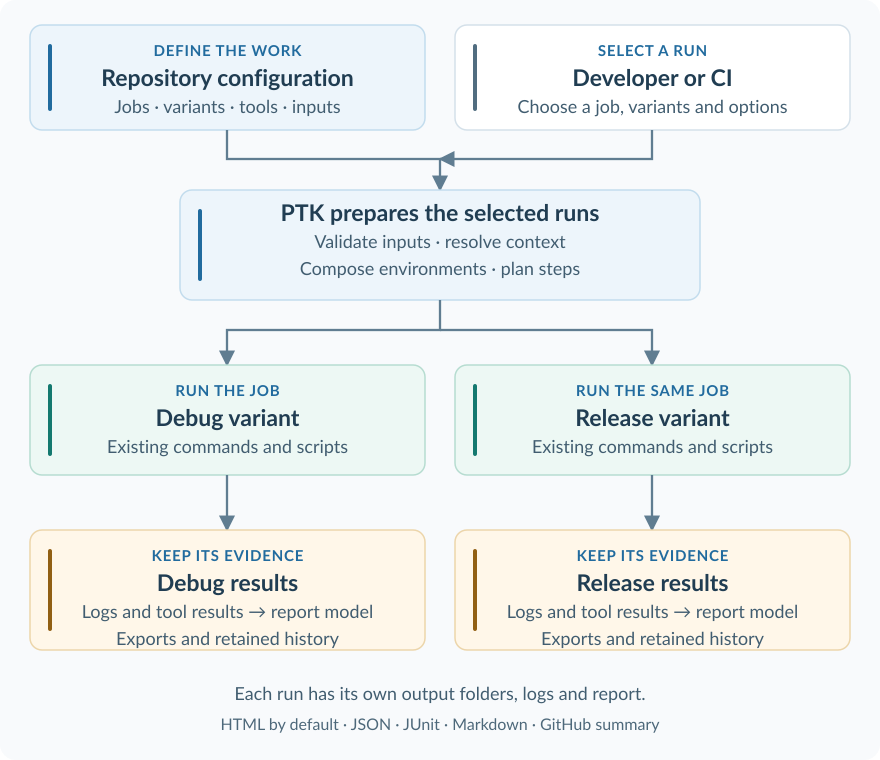

PTK — project tool kit
======================

.. toctree::
   :hidden:
   :maxdepth: 2
   :caption: Documentation

   guides/index
   requirements/index
   architecture/index
   reference/index
   ci/index

.. container:: ptk-hero

   .. rubric:: Your project. One familiar CLI.
      :class: ptk-hero-title

   .. container:: ptk-lead

      Turn the way your team builds, tests and delivers software into a shared,
      discoverable command-line interface.

   PTK is a configuration-driven automation toolkit. Describe your jobs,
   parameters, tools and product variants in YAML; PTK prepares their execution,
   runs your commands and collects the results. The knowledge of how to work
   with a project stays with the project.

   .. container:: ptk-actions

      .. button-ref:: /guides/getting-started
         :ref-type: doc
         :color: primary

         Run your first project

      .. button-ref:: /guides/configuration
         :ref-type: doc
         :color: primary
         :outline:

         Explore the configuration

   .. container:: ptk-hero-note

      Python 3.12+ · Windows and Linux · PowerShell and Bash / Git Bash

The idea
--------

A project needs more than a build command. Developers also need to know which
options to use, which tools to prepare, how to select a product variant and where
to look when something fails. PTK brings those decisions together in a common
execution model, described by reviewable files in your repository.

Start with one useful job around an existing command or script. Add typed
parameters, variants, tool setup or reports as the project needs them. Your
build system, test runner and project-specific code continue to do their work;
PTK gives the team a consistent way to invoke and understand that work.

Why teams use PTK
-----------------

.. grid:: 1 1 3 3
   :gutter: 3
   :class-container: ptk-benefits

   .. grid-item-card:: :octicon:`terminal` A CLI people can discover
      :class-card: ptk-card ptk-blue

      Jobs become commands with help, typed options and completion. Developers
      can inspect available choices and preview a run before executing it.

   .. grid-item-card:: :octicon:`git-branch` Variants without copied jobs
      :class-card: ptk-card ptk-teal

      Keep the job definition shared while selecting different features,
      components and data. Run one variant or several, with separate outputs.

   .. grid-item-card:: :octicon:`search` Evidence you can follow
      :class-card: ptk-card ptk-amber

      Find the command, step log, imported tool result and report for a run.
      Retained history helps explain what happened after the next run starts.

What you can do
---------------

.. grid:: 1 1 2 2
   :gutter: 3
   :class-container: ptk-capabilities

   .. grid-item-card:: :octicon:`play` Build, test and generate
      :class-card: ptk-card ptk-blue

      Run existing executables, shell commands and Python scripts as named
      steps. Declare inputs, conditions, timeouts, retries and parallel groups
      around the tools your project already uses.

      +++
      :doc:`Execution controls </reference/execution>` ·
      :need:`Related requirement <REQ_Sw_CONTROL>`

   .. grid-item-card:: :octicon:`git-branch` Model your product variants
      :class-card: ptk-card ptk-teal

      Describe features, component selections and constraints. Keep component
      definitions beside their code and run a job for several selected variants
      in parallel.

      +++
      :doc:`Configuration guide </guides/configuration>` ·
      :need:`Related requirement <REQ_Stkh_VARIANTS>`

   .. grid-item-card:: :octicon:`workflow` Compose local workflows
      :class-card: ptk-card ptk-blue

      Connect jobs into sequential or parallel workflows, including calls
      across independently configured repositories in a virtual monorepo.
      CI invokes jobs from its own pipeline.

      +++
      :doc:`Workflow guide </guides/workflows>` ·
      :need:`Related requirement <REQ_Sw_WORKFLOWS>`

   .. grid-item-card:: :octicon:`tools` Prepare the working environment
      :class-card: ptk-card ptk-teal

      Declare required tools, Python runtimes and credential providers.
      Compose job environments deliberately and use self-service commands for
      setup, diagnostics, completion and hooks.

      +++
      :doc:`Self-service commands </reference/cli>` ·
      :need:`Related requirement <REQ_Sw_ENVIRONMENT>`

   .. grid-item-card:: :octicon:`report` Understand failures and results
      :class-card: ptk-card ptk-amber

      Combine captured logs with JUnit, coverage and SARIF results. Review
      diagnostic severity, source logs and reasoned ignore/justify decisions
      in HTML, with other exports available from the same report model.

      +++
      :doc:`Logging and reporting </guides/log-analysis>` ·
      :need:`Related requirement <REQ_Stkh_LOG_ANALYSIS>`

   .. grid-item-card:: :octicon:`tag` Carry versions into your outputs
      :class-card: ptk-card ptk-blue

      Resolve project and component versions, generate version files and use
      runtime context in artifact destinations. Source Git identity remains
      distinct from the merge commit checked out by a PR pipeline.

      +++
      :doc:`Versioning guide </guides/versioning>` ·
      :need:`Related requirement <REQ_Sw_PR_SOURCE>`

   .. grid-item-card:: :octicon:`plug` Extend the shared toolkit
      :class-card: ptk-card ptk-teal

      Add trusted, explicitly selected Python plugins for steps, report
      formats, contributors, secret providers, installers and generators.
      Keep project-specific behavior in your project.

      +++
      :doc:`Plugin configuration </reference/plugins>` ·
      :need:`Related requirement <REQ_Sw_PLUGINS>`

   .. grid-item-card:: :octicon:`code` Bring the project into your editor
      :class-card: ptk-card ptk-blue

      Use the optional VS Code integration to browse configuration and run
      jobs. Synchronize the PTK expert agent and task-specific skills, with
      offline references matching the installed CLI.

      +++
      :doc:`Editor and authoring tools </guides/editor>` ·
      :need:`Related requirement <REQ_Sw_AGENT_SYNC>`

How a run fits together
-----------------------

The repository defines the available jobs and variants. A developer or a CI
pipeline selects a job; PTK validates the inputs, prepares each selected
variant's context and runs the configured steps. Logs and supported tool outputs
then feed a common report model.

   One job definition can serve several variants. Open the diagram to view it at full size.

A local workflow coordinates several such job runs. Build tools still compile;
test runners still execute tests; CI still schedules its pipeline. See the
:doc:`runtime view <architecture/06-runtime-view>` for preparation, cancellation
and report history.

Who is PTK for?
---------------

.. grid:: 1 1 2 2
   :gutter: 3

   .. grid-item-card:: Developers
      :class-card: ptk-card
      :link: guides/getting-started
      :link-type: doc
      :link-alt: Get started as a developer

      Discover the project's commands, select a variant and run a job with
      clear inputs. Use completion and reports to spend less time finding
      invocation details.

   .. grid-item-card:: Project maintainers
      :class-card: ptk-card
      :link: guides/configuration
      :link-type: doc
      :link-alt: Author your project configuration

      Capture repeatable work in conventional YAML files, keep component
      configuration close to its code and provide consistent defaults and
      authoring guidance for the team.

   .. grid-item-card:: CI and release engineers
      :class-card: ptk-card
      :link: ci/index
      :link-type: doc
      :link-alt: Understand CI and release preparation

      Invoke the same configured jobs from native pipelines. Select versions
      and environments explicitly, collect outputs and prepare artifacts
      using the project's release process.

   .. grid-item-card:: Test and quality engineers
      :class-card: ptk-card
      :link: guides/log-analysis
      :link-type: doc
      :link-alt: Inspect results and log diagnostics

      Follow failures back to their source logs, compare retained runs and
      record justified diagnostics while preserving the original execution
      and test outcomes.

Try a complete first run
------------------------

With PTK installed, create a small project that needs no compiler, credentials
or Git tags::

   ptk init my-project --name "My project" --config-dir config/ptk --yes
   cd my-project
   ptk --help
   ptk validate
   ptk hello --message "Hello from PTK"

The starter also includes debug/release variants and a build job. Continue with
:doc:`guides/getting-started` to preview a variant, run it and open its report.
When joining an existing project, start with ``ptk --help`` at its root.

Find your next step
-------------------

.. grid:: 1 1 2 2
   :gutter: 3

   .. grid-item-card:: Learn and configure
      :class-card: ptk-card
      :link: guides/index
      :link-type: doc

      Practical guides for configuration, workflows, versions, reports,
      distribution and authoring tools.

   .. grid-item-card:: Look up exact behavior
      :class-card: ptk-card
      :link: reference/index
      :link-type: doc

      Command syntax, generated configuration fields, execution controls
      and plugin contracts.

   .. grid-item-card:: Understand the design
      :class-card: ptk-card
      :link: architecture/index
      :link-type: doc

      System boundaries, building blocks, runtime behavior and tradeoffs,
      organized into twelve architecture chapters.

   .. grid-item-card:: Integrate with CI
      :class-card: ptk-card
      :link: ci/index
      :link-type: doc

      The verification pipeline, package preparation and the boundary
      between preparing an artifact and publishing it.
